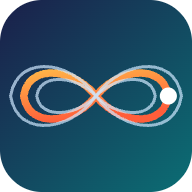

# Tabloop

**Version 0.59.2** · [what's new](https://tabloop.github.io/help/whats-new.html) · [detailed change log](CHANGELOG.md)

**Open the app: https://tabloop.github.io/**

**tabl∞p**: a free web app for practising with [feedpak](https://github.com/got-feedback/feedpak-spec) song packages (`.feedpak`): tab and notation that follow the music, multiple tracks side by side, loops by section and saved loops, pitch-preserving slow-down, pitch shift, a count-in, a speed trainer, a metronome, a tab synth, a mixer, practice tracking with streaks, and a song library with playlists, recently played songs and tuning badges.

- **Play along and see how you did:** a 🎸 tuner, ⏺ recorded takes you can loop and compare, and 👂 Live, which judges every note as you play (on time, in tune) without recording, shown as ghost notes on the tab or 🎯 markers under it; you choose how forgiving the judging is.
- **Sing along:** lyrics in time under the tab, and a 🎤 Vocals tab (karaoke) with the vocal melody, from the song, a MIDI file or found from its vocals track; 🎙 Sing shows your voice on the melody and scores each note.
- **Add parts:** MIDI drums (General MIDI, Rock Band / Clone Hero charts) and guitar, bass and keys from a MIDI file, synced to the recording and saved into the song.

How to use it:

- **Use it online:** open the link above in Chrome, Edge, Firefox or Safari. On iPhone or iPad, open it in Safari, then Share → *Add to Home Screen*.
- **New here?** Press **▶ Try the demo song** in the app, or read the [help & guide](https://tabloop.github.io/help/).
- **Use it offline:** download [`index.html`](index.html) and double-click it. It's a single self-contained file.
- **Sync across computers** (optional, Chrome or Edge): ⚙ Settings → *Sync folder*, then pick a folder that Google Drive, iCloud, Dropbox or OneDrive syncs.
- **Privacy:** songs you open stay on your device and nothing is uploaded, except an optional Google Drive backup of your settings, which you start yourself. No accounts and no cookies. The microphone is used only while you have the tuner, ⏺ Rec, 👂 Live or 🎙 Sing on. The web version sends anonymous usage counts (visits, new and active users without any user ID, songs played with an anonymous song ID, loops saved and takes recorded; song names only if you tick *share song names*); turn them off in ⚙ Settings. See the [privacy policy](privacy.html) and the [terms of use](terms.html).

## Credits

Built with open-source software: fflate (MIT), js-yaml (MIT), SoundTouchJS (LGPL-2.1), wasm-audio-decoders, simple-yenc (MIT), codec-parser (LGPL-3.0-or-later), @eshaz/web-worker (Apache-2.0), and libvorbis/libogg by Xiph.Org (BSD-3-Clause). The LGPL libraries are used unmodified. Full licence texts and source links are in the app: ⚙ Settings → *Credits and open-source licences*. Default string colours come from the Fee[dB]ack app.

Not affiliated with or endorsed by the got-feedback project; it reads their open feedpak format.
